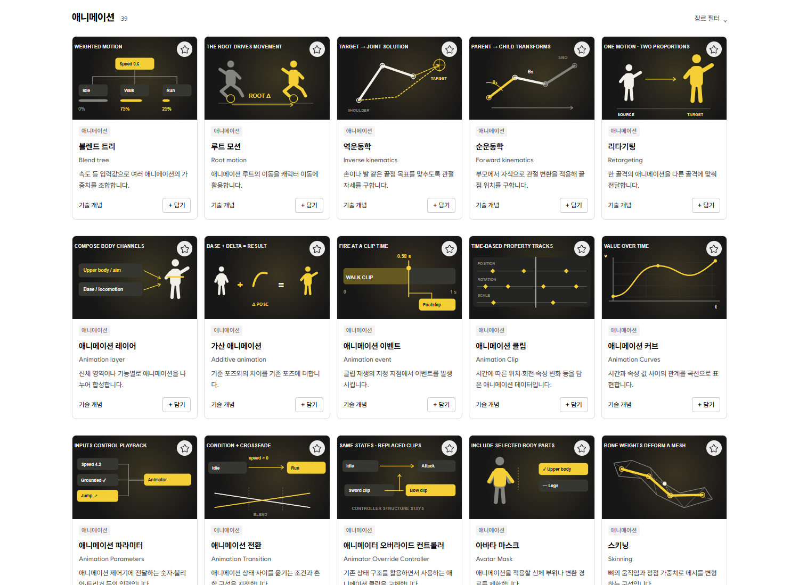

<div align="center">

# GamePrompt

### 게임 제작 표현 사전 · Game Development Prompt Dictionary

**게임 속 표현을 찾고, 이해하고, 프롬프트로.**

만들고 싶은 움직임과 연출을 탐색하고, 필요한 기술을 골라 AI에 전달할 요청 문장으로 조합하는 웹 도구입니다.

**[🌐 사이트 바로가기](https://mdj0126.github.io/GamePrompt/)**


[주요 기능](#주요-기능) · [사용 방법](#사용-방법) · [로컬 실행](#로컬-실행) · [구조](#구조)

<br>



<sub>개념별 도식과 설명을 함께 탐색하는 화면입니다. 도식은 개념 설명용이며 엔진 실행 결과가 아닙니다.</sub>

</div>

## 프로젝트 개요

| 항목 | 내용 |
| --- | --- |
| 프로젝트 | GamePrompt · 게임 프롬프트 |
| 목적 | 게임 제작 표현 탐색과 구현 요청 프롬프트 조합 |
| 콘텐츠 | 기본 카탈로그 기준 14개 카테고리 · 129개 게시물 |
| 프론트엔드 | HTML, CSS, Vanilla JavaScript, SVG |
| 콘텐츠 관리 | Markdown 원본 → JavaScript 카탈로그 생성 |
| 저장 방식 | 브라우저 localStorage |
| 실행 및 배포 | Node.js 로컬 서버 · GitHub Actions / Pages |

게임에서 본 효과나 움직임의 이름을 모를 때, 도식과 설명을 보고 필요한 개념을 찾을 수 있도록 만들었습니다. 선택한 기술은 장바구니에서 정리하고, 대상 엔진을 더해 한국어 또는 영어 프롬프트로 복사할 수 있습니다.

## 주요 기능

### 🔎 표현을 찾는 탐색과 검색

- 한글·영문 용어, 설명, 약어와 별칭 검색
- 카테고리와 게임 유형 필터, 입력 중 검색 추천
- 한국 시간 기준으로 매일 바뀌는 오늘의 추천
- 자주 사용하는 표현을 북마크로 저장

### 🎬 개념을 보여 주는 움직이는 도식

- 카메라, 전투, 애니메이션, 물리, 네트워크 등 게임 개발 주제별 시각화
- SVG와 CSS로 표현한 반복 애니메이션
- 전체 도식 재생·정지와 동작 줄이기 설정 대응
- 게시물 상세의 개념 설명, 참고 자료와 확인 범위

### 🛒 기술을 모아 프롬프트로 조합

- 게시물에서 필요한 기술을 선택하고 장바구니에서 목록 정리
- Unity, Unreal Engine, Godot 등 대상 엔진 선택
- 한국어·영어 요청 문장 조합과 클립보드 복사

사용자가 기술을 직접 선택하며, 앱에서 AI 모델을 호출하지 않습니다.

### 🌗 브라우저 안에서 이어지는 작업

- 선택한 기술, 북마크, 엔진과 언어 설정을 localStorage에 보관
- 밝은 테마와 어두운 테마, 모바일 레이아웃
- 로그인이나 API 키 없이 사용

## 사용 방법

1. 검색하거나 카테고리를 둘러보며 원하는 게임 표현을 찾습니다.
2. 게시물을 열어 도식, 개념 설명과 참고 자료를 확인합니다.
3. 필요한 기술의 **담기** 버튼을 누릅니다.
4. 장바구니에서 대상 엔진과 요청 언어를 선택합니다.
5. 완성된 프롬프트를 복사해 사용하는 외부 AI에 전달합니다.

## 로컬 실행

**Node.js 18 이상**이 필요하며, 별도 패키지 설치 없이 실행할 수 있습니다.

```bash
git clone https://github.com/MDJ0126/GamePrompt.git
cd GamePrompt
npm start
```

브라우저에서 [localhost:4173](http://localhost:4173)을 여세요. 종료는 `Ctrl+C`입니다. 다른 포트는 `PORT` 환경 변수로 지정할 수 있습니다.

## 구조

```text
site/
├─ index.html              # 탐색 화면
├─ app.js                  # 검색·선택·저장·프롬프트 조합
├─ articles/               # 게시물 Markdown 원본
├─ catalog.js              # 생성된 기본 카탈로그
├─ articles-ui.js          # 게시물 상세 화면
├─ suggestions.js          # 검색 추천
├─ animation-art.js        # 애니메이션 개념 도식
├─ technical-art.js        # 기술 개념 도식
├─ covers/                 # 게시물 SVG 커버
└─ *.css                   # 레이아웃·테마·반응형 스타일
scripts/                   # 콘텐츠·커버 생성 및 일치 검사
tests/                     # 콘텐츠와 주요 동작 테스트
.github/workflows/         # 검증 후 GitHub Pages 배포
server.js                  # 로컬 정적 파일 서버
```

게시물은 Markdown에서 관리하고 검색에 사용하는 카탈로그는 스크립트로 생성합니다. 콘텐츠 수정 시 생성 결과의 일치 여부를 검사하며, GitHub Actions에서도 검사를 통과한 뒤 `site/`를 배포합니다.

## 검증

```bash
npm test
```

카탈로그·커버 생성 결과와 원본의 일치 여부, 게시물 구조, 검색·선택·프롬프트·저장 동작 및 도식을 검사합니다.

Unity C#과 Unreal C++ 예제는 구조를 설명하는 최소 코드입니다. 이 저장소의 테스트로 엔진 컴파일·실행을 검증하지는 않습니다. 출처, 문서 버전, 마지막 확인일과 미검증 범위는 게시물에서 확인할 수 있습니다.

## 콘텐츠 관리와 배포

[게시물 작성 · 이미지 생성 · Pages 배포와 이전 작업 기록](docs/MAINTENANCE.md)

도식과 요청 예시는 이 프로젝트에서 작성했습니다. 기술 자료의 출처는 각 게시물에 표시하며, 포함된 Wanted Sans 폰트의 라이선스는 [WantedSans-OFL.txt](site/fonts/WantedSans-OFL.txt)에서 확인할 수 있습니다.
